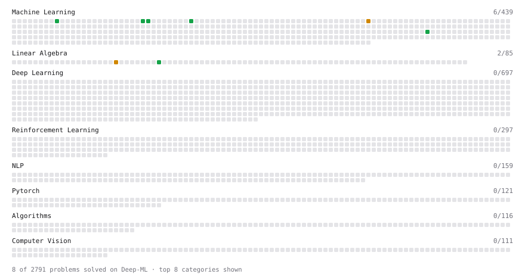

# Deep-ML

My machine learning practice from [Deep-ML](https://www.deep-ml.com). Every solution here was written by hand.

**15** solved · 9 problems · 0 labs · 6 math

[**Browse the interactive portfolio**](https://VagrantAC.github.io/deep-ml/) to replay this filling in over time.

## Problems

| | Difficulty | Solved | |
| --- | --- | --- | --- |
| [Calculate Mean Absolute Error (MAE)](https://www.deep-ml.com/problems/93) | easy | 2026-11-22 | [solution](problems/0093-calculate-mean-absolute-error-mae) |
| [Calculate R-squared for Regression Analysis](https://www.deep-ml.com/problems/69) | easy | 2026-11-22 | [solution](problems/0069-calculate-r-squared-for-regression-analysis) |
| [Calculate Root Mean Square Error (RMSE)](https://www.deep-ml.com/problems/71) | easy | 2026-11-22 | [solution](problems/0071-calculate-root-mean-square-error-rmse) |
| [Dot Product Calculator](https://www.deep-ml.com/problems/83) | easy | 2026-11-28 | [solution](problems/0083-dot-product-calculator) |
| [Random Shuffle of Dataset](https://www.deep-ml.com/problems/29) | easy | 2026-11-22 | [solution](problems/0029-random-shuffle-of-dataset) |
| [Random Train/Validation/Test Split with Shuffling](https://www.deep-ml.com/problems/1058) | easy | 2026-11-22 | [solution](problems/1058-random-train-validation-test-split-with-shuffling) |
| [Gaussian Elimination for Solving Linear Systems](https://www.deep-ml.com/problems/58) | medium | 2026-11-28 | [solution](problems/0058-gaussian-elimination-for-solving-linear-systems) |
| [Implement Stratified Train-Test Split](https://www.deep-ml.com/problems/275) | medium | 2026-11-22 | [solution](problems/0275-implement-stratified-train-test-split) |
| [Partitioned Inverse via Schur Complements](https://www.deep-ml.com/problems/1775) | medium | 2026-11-28 | [solution](problems/1775-partitioned-inverse-via-schur-complements) |

## Math

| | Difficulty | Solved | |
| --- | --- | --- | --- |
| [Matrix Multiplication](https://www.deep-ml.com/math-problems/10) | medium | 2026-11-28 | [solution](math/0010-matrix-multiplication) |
| [Missing-Data Mechanisms: MCAR, MAR, NMAR and the Bias of Mean Imputation](https://www.deep-ml.com/math-problems/354) | medium | 2026-11-21 | [solution](math/0354-missing-data-mechanisms-mcar-mar-nmar-and-the-bias-of-mean-imputation) |
| [Regularization and Generalization](https://www.deep-ml.com/math-problems/31) | medium | 2026-11-22 | [solution](math/0031-regularization-and-generalization) |
| [Schur Complements and the Partitioned Inverse](https://www.deep-ml.com/math-problems/409) | medium | 2026-11-28 | [solution](math/0409-schur-complements-and-the-partitioned-inverse) |
| [Training Error, Test Error and the Bayes Rate](https://www.deep-ml.com/math-problems/104) | medium | 2026-11-22 | [solution](math/0104-training-error-test-error-and-the-bayes-rate) |
| [Woodbury, Sherman-Morrison and the Matrix Determinant Lemma](https://www.deep-ml.com/math-problems/410) | medium | 2026-11-28 | [solution](math/0410-woodbury-sherman-morrison-and-the-matrix-determinant-lemma) |

---

_This file is regenerated by Deep-ML on every push._
